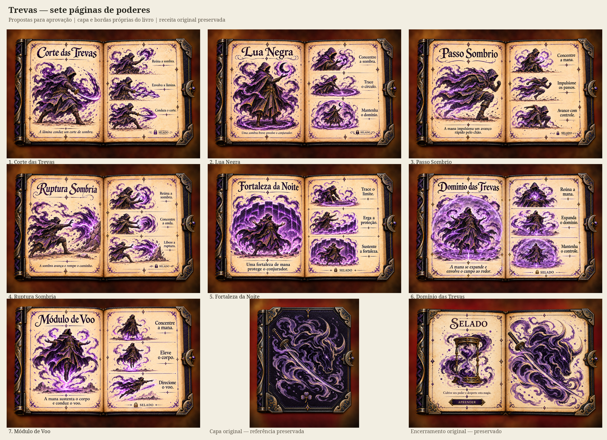
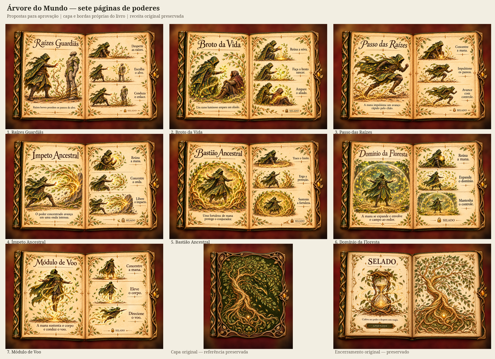
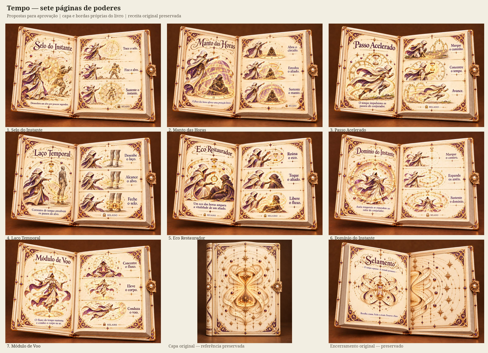
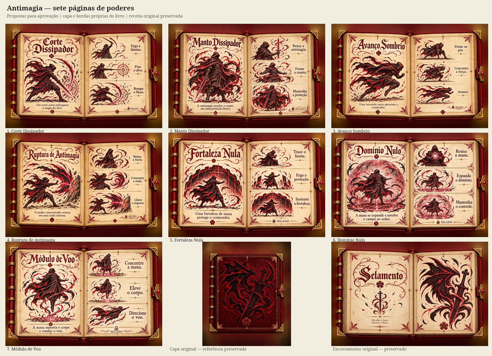
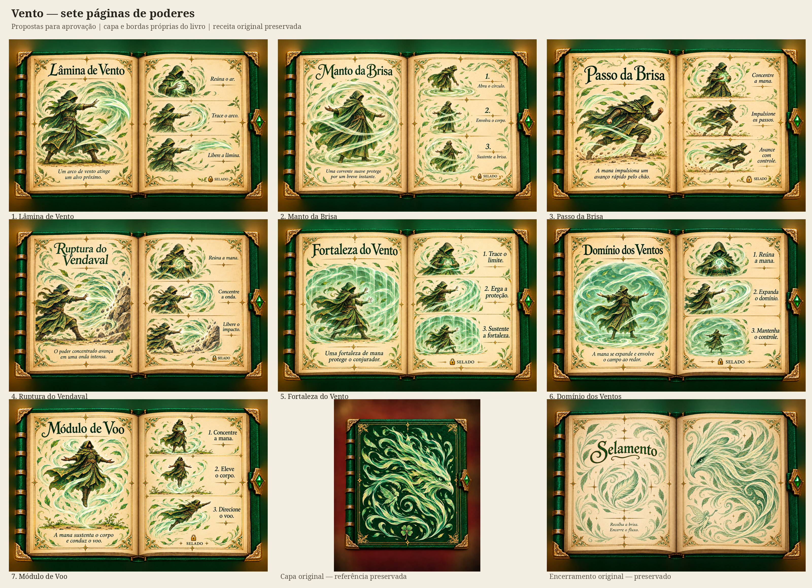
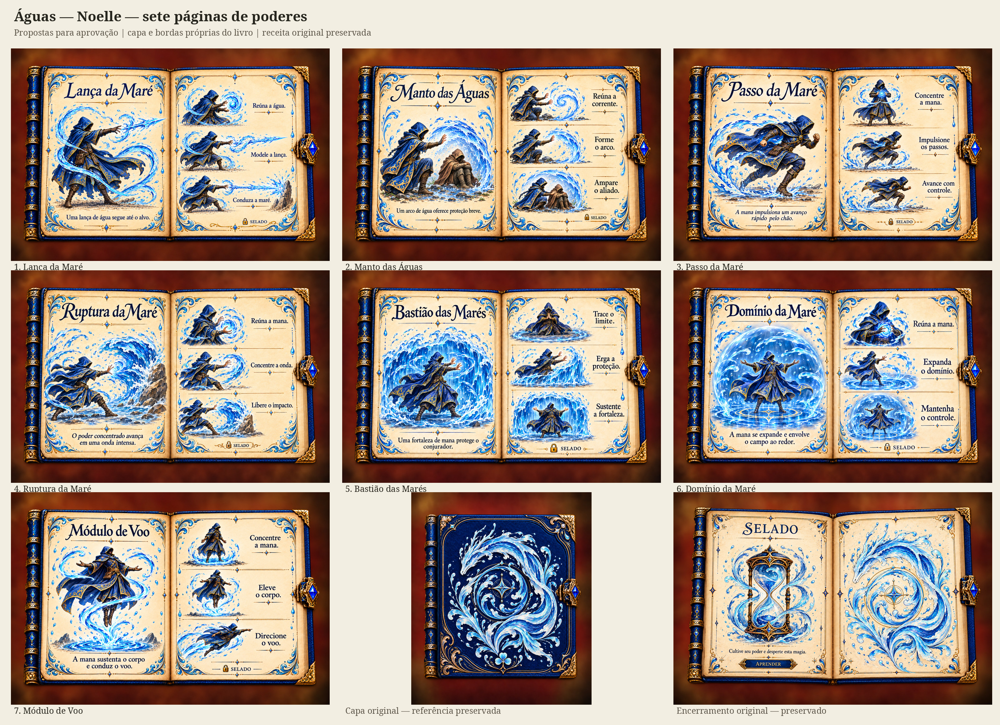
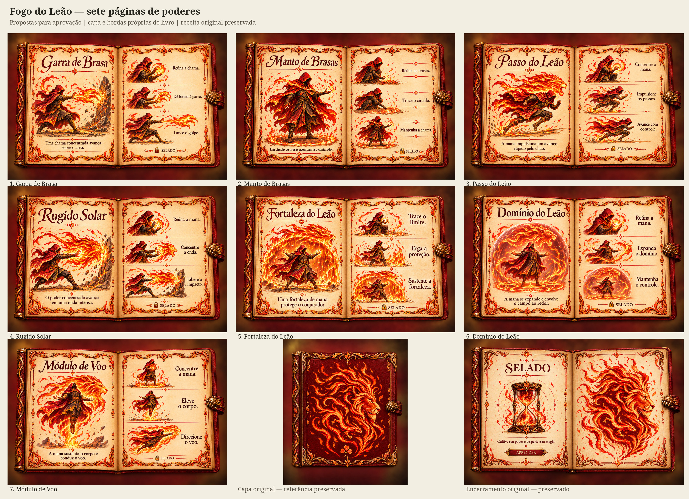
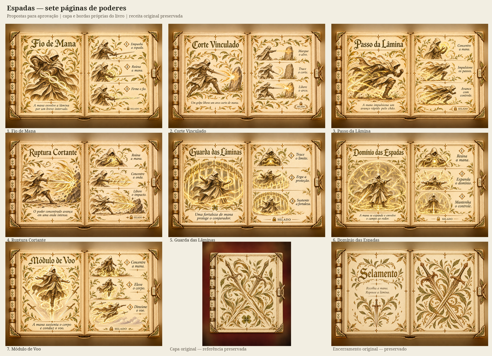
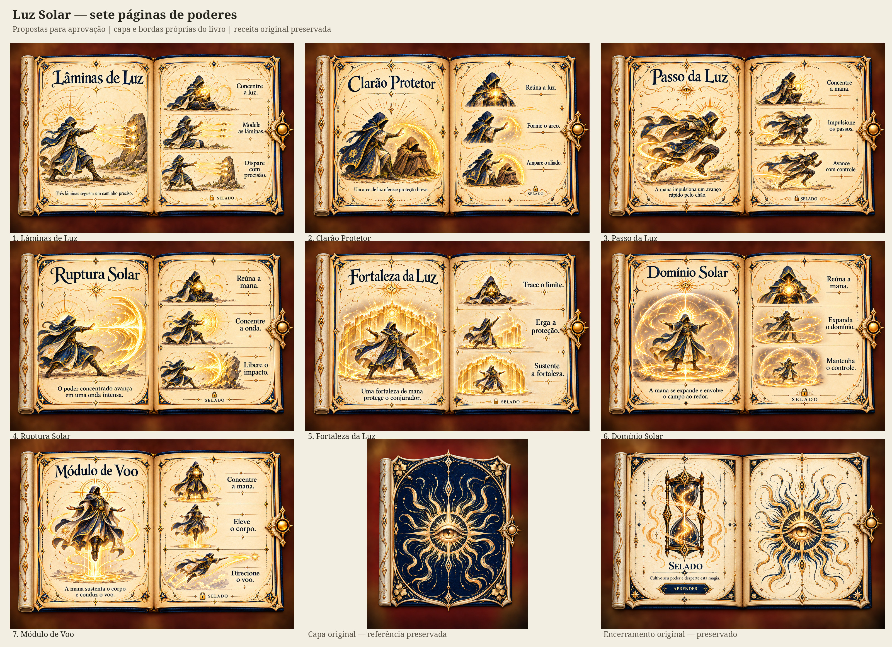

# Artes completas dos nove grimórios restantes

**63 páginas de poderes: sete para cada um dos nove livros.** Além dos poderes propostos, cada pasta contém a capa, a abertura e o encerramento originais, copiados sem alteração. Os seis livros até Cura não foram alterados.

Esta entrega contém somente imagens e documentos de aprovação. Não contém alterações de tamanho, CSS, posição, recortes de execução, folheamento, manifesto de recurso, controles, catálogo do jogo ou efeitos dos poderes. As artes novas não foram instaladas no recurso. Os nomes novos e as descrições são propostas, não poderes programados.

## Livros

Trevas; Árvore do Mundo; Tempo; Antimagia; Vento; Águas (Noelle); Fogo do Leão; Espadas; Luz Solar.

Cada livro está em `artes/tema/`: capa original, abertura original, sete PNGs de poderes com 1536 × 1024, encerramento original e `SEQUENCIA.json`. Os JPGs são prévias menores das mesmas artes para exibir no chat. Os PNGs gerados estão preservados sem redimensionamento ou recompressão.

`previas/` contém nove pranchas com as sete páginas de cada livro. `ATLAS_63_PAGINAS_DE_PODER.pdf` reúne as 63 páginas em tamanho grande para revisão. `MANIFESTO.json` registra títulos, textos, dimensões e hashes.

As bordas das novas páginas foram dirigidas pelas capas e aberturas originais de cada livro, sem reutilizar a moldura de Cura nos outros temas. Cura foi usado como referência de composição interna. A aprovação visual dos contornos e das artes continua pendente; as imagens não devem ser integradas antes dessa aprovação.

## Trevas

[Ver as sete páginas individualmente](artes/trevas/README.md)

## Árvore do Mundo

[Ver as sete páginas individualmente](artes/arvore_mundo/README.md)

## Tempo

[Ver as sete páginas individualmente](artes/tempo/README.md)

## Antimagia

[Ver as sete páginas individualmente](artes/antimagia/README.md)

## Vento

[Ver as sete páginas individualmente](artes/vento/README.md)

## Águas — Noelle

[Ver as sete páginas individualmente](artes/noelle/README.md)

## Fogo do Leão

[Ver as sete páginas individualmente](artes/fogo_leao/README.md)

## Espadas

[Ver as sete páginas individualmente](artes/espadas/README.md)

## Luz Solar

[Ver as sete páginas individualmente](artes/luz_solar/README.md)

