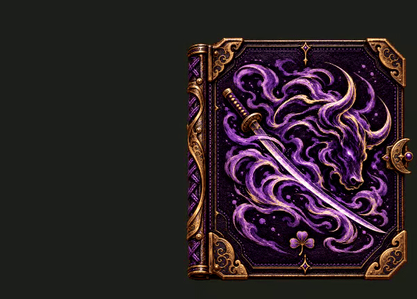
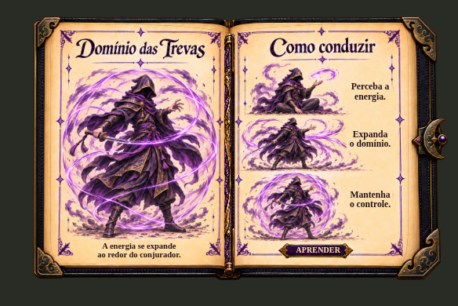

# Prévia para aprovação — lombada central permanente

Proposta visual isolada. A versão publicada para o jogo continua v1.2.2; nenhum arquivo do recurso instalado foi substituído.

A lombada se desloca rapidamente até a junção das folhas ao abrir, fica mais estreita e permanece ali durante a leitura e o folheamento. Ao fechar, volta à posição da capa. Permanece visível e opaca, sem fade ou ocultação.

**[Assistir à abertura e ao fechamento](lombada_central_previa_1.mp4)**

## Livro aberto

## Página de poder

[Sequência fechado, abrindo e aberto](sequencia.jpg) · [Conferência da prévia](CONFERENCIA.json)

Renderizado no navegador no tamanho do teste. Não é uma gravação de servidor RedM. As artes e as legendas são as da versão já publicada; a diferença visual aberta ficou restrita ao centro do livro. Esta proposta aguarda aprovação do acabamento antes de gerar uma atualização do recurso.
