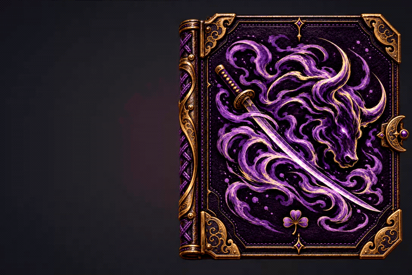
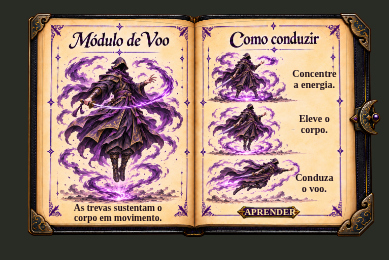

# Trevas completo v1.3.0 — abertura exata do HTML enviado

**[Baixar o pacote completo atualizado — ZIP](https://github.com/lucasbmaia96-netizen/clover2/raw/refs/heads/trevas-teste-redm/GRIMORIO_TREVAS_COMPLETO_v1.3.0.zip)** · [Instalação](LEIA_ME_PACOTE_COMPLETO_v1.3.0.md) · [Conferência](PACOTE_COMPLETO_v1.3.0.json)

O arquivo `GRIMORIO_TREVAS_ABERTURA_SEM_SOBREPOSICAO.html` enviado pelo usuário está preservado byte a byte dentro do recurso, mantendo o nome interno anterior para compatibilidade. A antiga intervenção na lombada foi retirada. Abertura, fechamento, recortes, camadas e tempos são os do HTML recebido.

**Conferência em navegador: 19 quadros de abertura e fechamento idênticos à referência**, no mesmo modo Tamanho do jogo. Os tempos nativos de 1120 ms e o modo reduzido de 120 ms também foram preservados. NumPad 0 a 8, setas invertidas e legendas legíveis continuam funcionando.

[Ver abertura e fechamento](https://github.com/lucasbmaia96-netizen/clover2/raw/refs/heads/trevas-teste-redm/previas/html/abertura_html_usuario_v1.3.0.mp4) · [Ver sequência de quadros](previas/html/sequencia_html_usuario_v1.3.0.jpg)

O pacote é completo e dispensa os anteriores. Extraia `grimorio_trevas_teste` nos recursos, preserve seu config.lua se personalizado e execute `ensure grimorio_trevas_teste`. No jogo, abra com `/trevasteste`. A execução no servidor RedM deve ser conferida com esta instalação.

---

# Prévia — lombada no centro durante a abertura

**[Ver o vídeo da proposta](https://github.com/lucasbmaia96-netizen/clover2/raw/refs/heads/trevas-teste-redm/previas/lombada_central/ABERTURA_LOMBADA_CENTRAL.mp4)** · **[Baixar a prévia em HTML, folheável](https://github.com/lucasbmaia96-netizen/clover2/raw/refs/heads/trevas-teste-redm/previas/lombada_central/PREVIA_LOMBADA_CENTRAL_01.zip)**

A lombada permanece visível. Durante a abertura, ela se acomoda na dobra central e mantém o couro e os detalhes dourados à mostra depois que o livro termina de abrir. O fechamento devolve o perfil à lateral. A prévia permite repetir a abertura e folhear com as teclas atuais.

Esta é uma proposta visual para revisar o movimento antes de aplicar ao recurso do servidor. [Instruções](previas/lombada_central/LEIA_ME.md) · [Livro aberto](previas/lombada_central/LIVRO_ABERTO_LOMBADA_CENTRAL.jpg) · [Conferência](previas/lombada_central/CONFERENCIA.json).

---

# Trevas v1.2.2 — lombada sólida durante o giro e NumPad 8

**[Baixar o pacote COMPLETO atualizado v1.2.2 — ZIP](https://github.com/lucasbmaia96-netizen/clover2/raw/refs/heads/trevas-teste-redm/GRIMORIO_TREVAS_COMPLETO_v1.2.2.zip)**

Contém todos os arquivos necessários do recurso `grimorio_trevas_teste`; não precisa dos pacotes antigos nem de patches. Extraia a pasta completa para os recursos do servidor. Na primeira instalação use `ensure grimorio_trevas_teste`; para atualizar uma instalação existente, substitua os arquivos, preserve seu config.lua se personalizado e execute `restart grimorio_trevas_teste`. No jogo, abra com `/trevasteste`. [Instruções completas](LEIA_ME_PACOTE_COMPLETO_v1.2.2.md) · [Conferência do pacote](PACOTE_COMPLETO_v1.2.2.json).

**[Baixar a atualização pequena — ZIP](https://github.com/lucasbmaia96-netizen/clover2/raw/refs/heads/trevas-teste-redm/ATUALIZACAO_TREVAS_LOMBADA_NUMPAD8_v1.2.2.zip)** · [Instruções](LEIA_ME_ATUALIZACAO_v1.2.2.md) · [Conferência](ATUALIZACAO_v1.2.2.json)

Para quem está na v1.2.1: copie sobre `grimorio_trevas_teste`, mantendo os demais arquivos e o config.lua, e execute `restart grimorio_trevas_teste` no console do servidor. Abra com `/trevasteste`.

A lombada permanece **fixa e totalmente opaca até o giro da capa terminar**. Foi retirado o fade que causava o efeito de fantasma. Ela só é recolhida depois que o livro está completamente aberto; no fechamento permanece sólida atrás da parte interna da capa.

**NumPad 8** abre a última página, com a espada. NumPad 1 a 7, NumPad 0, setas invertidas e as legendas em HTML são mantidos. A nova tecla também funciona com NumLock desligado e ao partir da capa fechada.

[Ver abertura, fechamento e página da espada](https://github.com/lucasbmaia96-netizen/clover2/raw/refs/heads/trevas-teste-redm/previas/html/lombada_solida_numpad8_v1.2.2.mp4) · [Ver a lombada durante o giro](previas/html/lombada_solida_durante_giro_v1.2.2.jpg)

Comparação visual e testes feitos no Chromium, sem execução de servidor RedM. O pacote tem apenas dois arquivos do recurso e as instruções; mantém o HTML de entrada antigo, as artes e o tamanho do livro.

---

# Trevas — comparação do pacote e revisão da entrada HTML

**[Comparação arquivo por arquivo](comparacao/COMPARACAO_ARQUIVO_POR_ARQUIVO.md)** · [Diferenças exatas](comparacao/ALTERACOES.diff) · [Proveniência da imagem e da fonte](comparacao/PROVENIENCIA.json)

O pacote v1.2.0 foi sinalizado pelo Windows Defender. O registro de evento 1116 identifica `grimorio_trevas_teste/html/index.html`. A comparação com o pacote antigo encontrou três arquivos idênticos, três alterados e cinco adicionados; não há arquivos inesperados. As únicas mudanças no index.html eram duas chamadas de scripts, acrescentadas nesta sessão.

## Revisão candidata v1.2.1

**[Abrir o ZIP da revisão para validação no GitHub](https://github.com/lucasbmaia96-netizen/clover2/blob/trevas-teste-redm/CORRECAO_ENTRADA_TREVAS_v1.2.1_PARA_VALIDACAO.zip)** · [Instruções](LEIA_ME_ENTRADA_v1.2.1.md) · [Conferência](REVISAO_ENTRADA_v1.2.1.json)

Restaurei o index.html byte a byte igual ao ZIP antigo. As funções de legendas, lombada e teclado passam a ser carregadas pelo JavaScript existente, em texto legível, sem ofuscação. O código separado usado na montagem está em [comparacao/fontes_v1.2.1](comparacao/fontes_v1.2.1).

**A revisão precisa de validação pelo Defender.** Os testes de funcionamento e a revisão do código não confirmam um falso positivo. Se o antivírus bloquear, não force o download nem desative a proteção. O ZIP v1.2.0 continua em revisão.

## Funcionalidade preservada

- `/trevasteste` abre o grimório.
- NumPad 1 a 7 seleciona o poder junto da explicação; NumPad 0 abre a introdução.
- Seta esquerda avança; seta direita volta. Esc fecha.
- Lombada fixa, capa girando na junção, legendas HTML maiores e o mesmo tamanho do livro.

As sete aberturas foram comparadas pixel a pixel e permanecem iguais à versão legível anterior. O NumPad, as setas, o mouse, Aprender, Esc e a abertura/fechamento passaram na conferência com Chromium e funções Cfx simuladas. Não foi executado o Defender neste ambiente, nem um servidor RedM.

O HTML ilustrado original e o config.lua são preservados e não são repetidos no ZIP. O recurso continua `grimorio_trevas_teste` e permanece separado de `grimorio_oficial`. Os pacotes antigos continuam arquivados para comparação.
