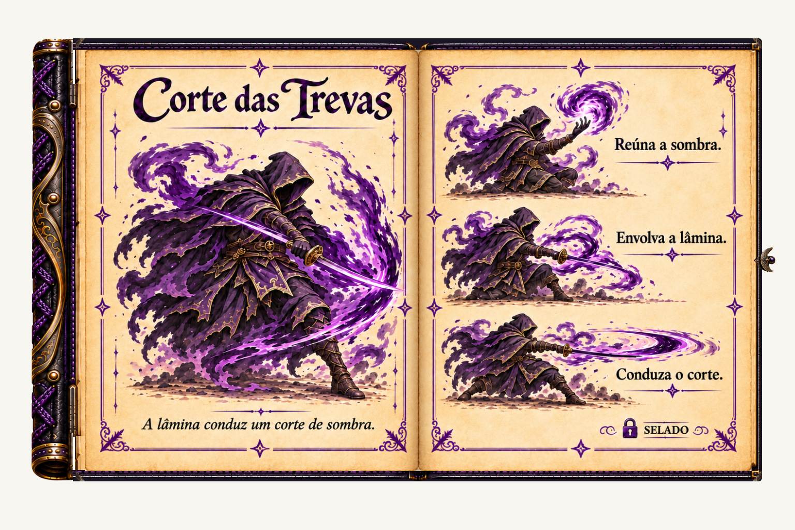

# Trevas — HTML folheável para acertar o modelo

**[Baixar o HTML completo em ZIP](https://github.com/lucasbmaia96-netizen/clover2/raw/refs/heads/trevas-html/TREVAS_HTML_PARA_TESTE.zip)**

Extraia o ZIP e abra **`TREVAS_FOLHEAVEL.html`** no navegador. O arquivo contém todas as imagens; não precisa de servidor nem de pastas de imagens separadas.

O modelo inclui a abertura, sete páginas completas de poderes e o encerramento. Clique na metade direita ou esquerda do livro, use as setas do teclado ou os botões Anterior e Próxima. O botão Fechar capa permite conferir a abertura e o fechamento. Tamanho do jogo mostra o livro na mesma largura e posição da interface original; Ampliar para conferir volta à visualização maior.

As folhas agora usam artes de papel separadas da capa. As quatro cantoneiras são menores e fixas; o fecho lateral foi reduzido e colocado fora da área do papel. A margem visível da contracapa é estreita: aproximadamente 20 pixels na montagem de 1536 × 1024. As duas folhas têm a mesma largura e viram sem carregar ferragens ou pedaços da capa.

Este é um protótipo somente do Trevas, separado do recurso instalado. Os outros grimórios continuam como estavam. O resultado foi conferido no navegador; serve para aprovar a montagem antes de adaptá-la ao jogo e aos demais livros.

[Conferência do folheamento e das margens](CONFERENCIA.json)
