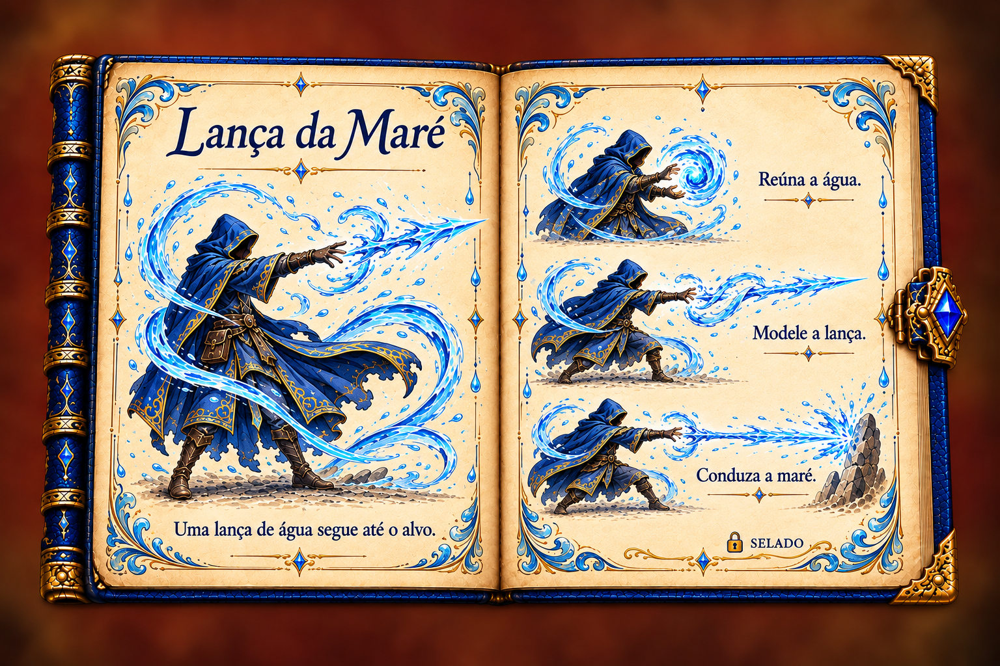
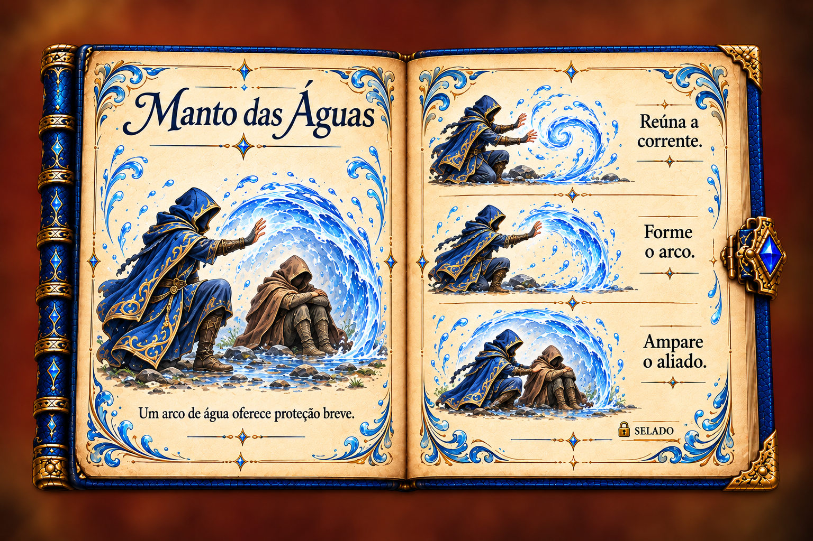
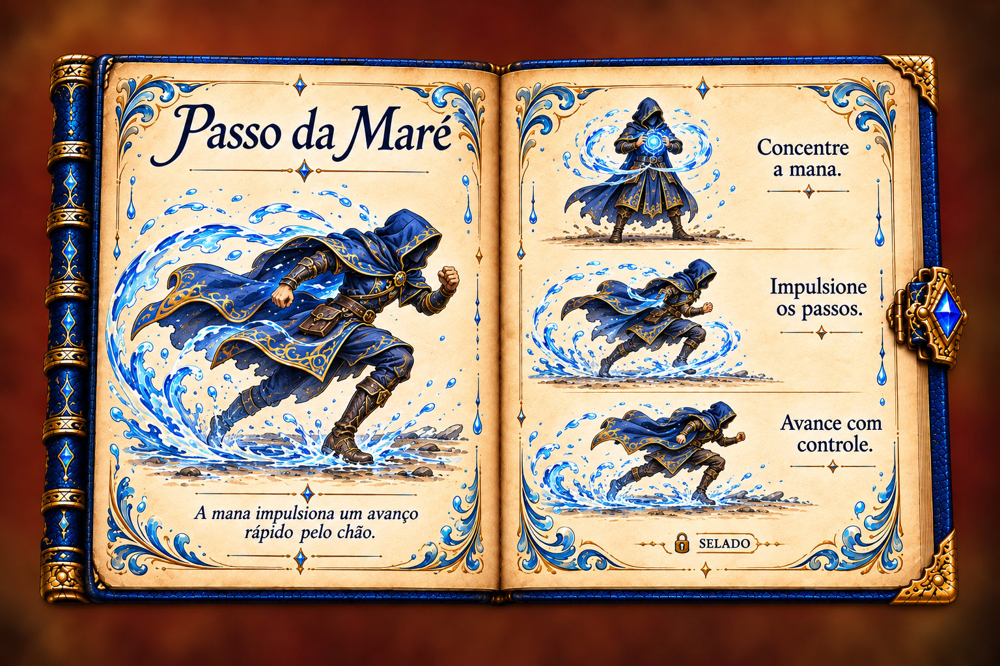
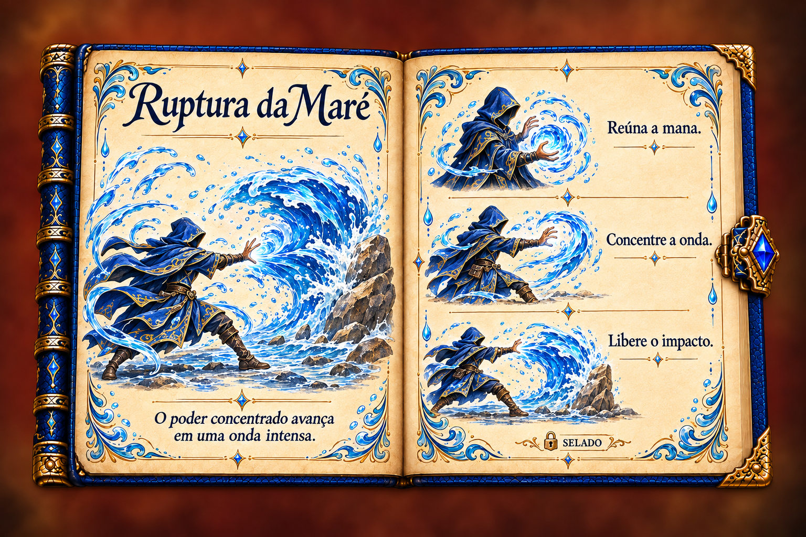
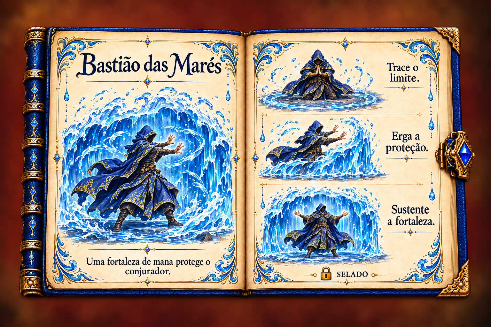
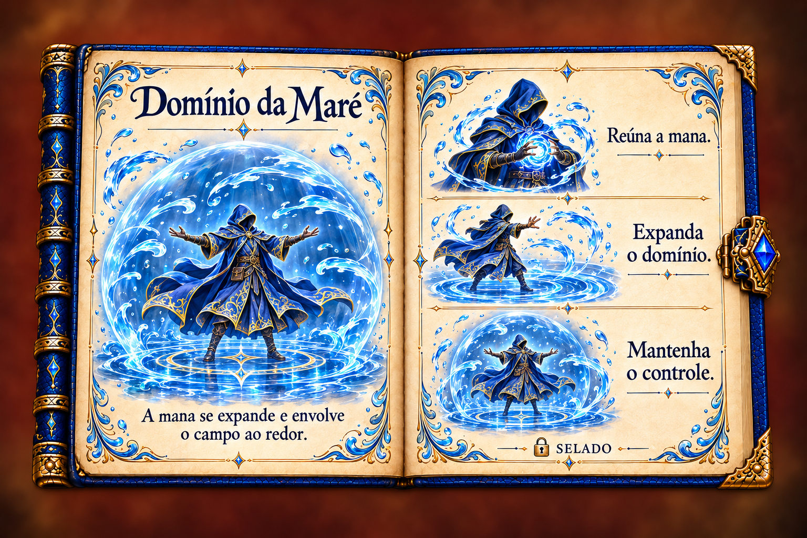
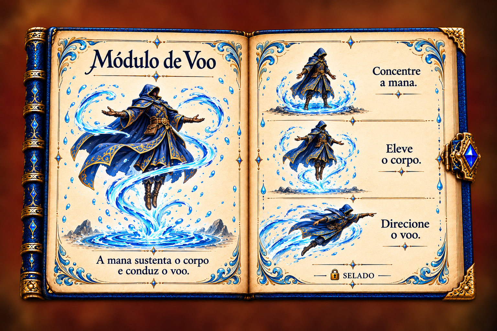

# Águas — Noelle — sequência completa para aprovação

Capa, abertura e encerramento originais; sete páginas internas propostas. Nenhuma alteração na receita do jogo.

[Capa original](01_Capa_Original.png) · [Abertura original](02_Abertura_Original.png) · [Encerramento original](12_Encerramento_Original.png)

## 1. Lança da Maré

[PNG original da arte](03_Poder_1.png)

## 2. Manto das Águas

[PNG original da arte](04_Poder_2.png)

## 3. Passo da Maré

[PNG original da arte](07_Avanco.png)

## 4. Ruptura da Maré

[PNG original da arte](08_Ataque_Elite.png)

## 5. Bastião das Marés

[PNG original da arte](09_Defesa_Elite.png)

## 6. Domínio da Maré

[PNG original da arte](10_Zona_Mana.png)

## 7. Módulo de Voo

[PNG original da arte](11_Modulo_Voo.png)
